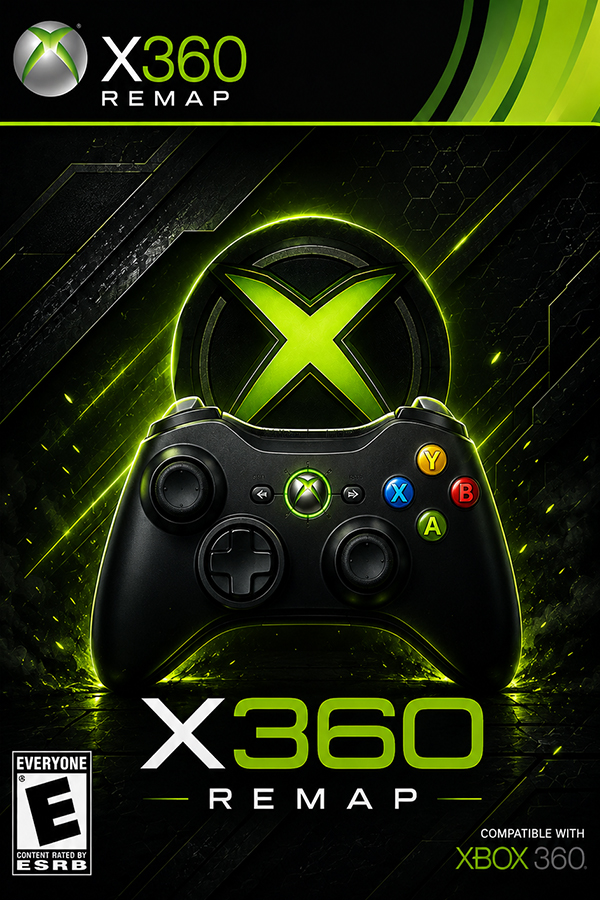

# X360Remap

**Mouse and keyboard on a real Xbox 360** (RGH / JTAG, DashLaunch). No adapter,
no dongle: a DashLaunch plugin turns your USB mouse and keyboard into a
controller, and an on-console app lets you set everything up.

A fork of [hiddriver360](https://github.com/EinTim23/hiddriver360) by EinTim23.



---

## ⚠️ Read before installing

- **This is a fork of hiddriver360. Do not load both plugins.** They hook the
  same USB functions and will conflict. Remove hiddriver360 from
  `launch.ini` and load **X360Remap alone**.
- **`xbdm.xex` is required.** It must be loaded in DashLaunch as well. Without
  it, the console freezes as soon as a USB input device is connected.
- **USB freezes:** 1.4 removed their main cause (the USB restart at boot).
  If one still happens, send the logs (see the guide).
- **Offline only.** X360Remap is made for single-player, split-screen and
  private matches — not for playing online against other people.

---

## What's in 1.4.1 (preview)

- **Keyboard and mouse are always player 1**, whatever the plug order. The
  Xbox sign-in window now answers them. **Scroll Lock** merges controller and
  keyboard/mouse into one player when you want.
- **Much more stable USB:** no more restart of the whole USB system at boot.
  Optional per-port restart for the Slim's front ports (the Wi-Fi card is not
  touched).
- **In-game display:** FPS and temperatures, input help over the game.
- **Controller page and combo macros**, **12 more direct aim games**, and the
  **Windows Studio** (install wizard, live device status, camera finder).

Full notes: [docs/RELEASE_1.4.1-pre.md](docs/RELEASE_1.4.1-pre.md) ·
History: [CHANGELOG.md](CHANGELOG.md) · What's next: [ROADMAP.md](ROADMAP.md)

---

## Install

Download `X360Remap_1.4.1-pre_console.zip` from the
[releases](https://github.com/HB-Agadir/X360Remap/releases). It contains:

```
X360Remap.xex                       -> the plugin, copy to HDD:\
X360RemapStudio\X360RemapStudio.xex -> the app, copy the folder to HDD:\
optional\Slim_front_USB_ports\      -> Slim only: front USB ports without replug
X360Remap_Guide.html                -> the guide, in English and Arabic
```

1. Copy `X360Remap.xex` to `HDD:\X360Remap.xex` and the `X360RemapStudio`
   folder to `HDD:\X360RemapStudio\`.
2. In `launch.ini`, load the plugin **and xbdm**, and remove hiddriver360 if
   present, for example:
   ```
   plugin1 = Hdd:\xbdm.xex
   plugin2 = Hdd:\X360Remap.xex
   ```
   (Keep the paths your own setup already uses for xbdm.)
3. Add `HDD:\X360RemapStudio\X360RemapStudio.xex` to Aurora.
4. Reboot the console. A keyboard or mouse plugged in at power-on must be
   replugged once Aurora is on screen.

Easier: the Windows Studio (`X360RemapStudio-1.4.1-pre-win64.zip`) does the
whole install from your PC (*File > Install X360Remap on the console*).

Both files are required. With the plugin alone, default controls work but the
Studio is what saves your settings and profiles.

---

## Build from source

Visual Studio 2010 toolset with the Xbox 360 SDK. Open `X360Remap.sln`,
configuration **Release Retail | Xbox 360**. It produces:

- `X360Remap\Release Retail\X360Remap.xex`
- `application\Release Retail\X360RemapStudio.xex`

The Windows Studio: `windows/X360RemapWindows.sln`, **Release | x64** (or
`windows/package.ps1`, which also makes the zip). Tests: `windows/tests/run_tests.ps1`.

---

## Choices and known issues

- **No recoil change - on purpose.** People asked whether X360Remap could
  lower weapon recoil. It could technically be found, but removing recoil is
  the classic online cheat, and adding it would get X360Remap seen as a cheat
  tool. So it stays out. Comfort options may come later instead (turning off
  view / weapon bob, lowering aim assist for offline play).

---

## Companion tool: Xenia Camera Finder

Direct aim needs to know where each game keeps its camera.
**[Xenia Camera Finder](https://github.com/HB-Agadir/Xenia-Camera-Finder)** finds
it automatically on your PC, with the Xenia emulator, and gives you one line to
put in `HDD:\X360RemapStudio\camera_addresses.txt` — or to send us, so the game
gets direct aim for everyone. It is how MW3, MW2, Metro 2033 and Metro: Last
Light were added.

---

## Support the project

X360Remap is a free, solo, spare-time project. Donations go first to the
hardware needed for the next milestones (other controllers, a racing wheel,
an arcade stick, a capture card for demo videos) — see
[ROADMAP.md](ROADMAP.md#community-goals).

- Ko-fi: <https://ko-fi.com/x360remap>
- PayPal: <x360remap@gmail.com>

Bug reports, logs and test results are just as valuable: open an issue.

**Which devices work, which ones we want to support next, and how to help:**
see [DEVICES.md](DEVICES.md).

---

## Credits

- [hiddriver360](https://github.com/EinTim23/hiddriver360) by EinTim23
  (GPL-3.0) — the USB HID groundwork this fork builds on.
- [Xenia Canary Mousehook](https://github.com/Clippy95/xenia-canary-mousehook)
  (BSD) — camera addresses for several Call of Duty builds.
- [GIMX](https://github.com/matlo/GIMX) (GPL-3.0): the mouse-to-stick method
  (dead zone, curve, filter, residue) in `X360Remap/mapping.cpp`.
- [Dear ImGui](https://github.com/ocornut/imgui) (MIT),
  [RapidJSON](https://github.com/Tencent/rapidjson) (MIT),
  [stb_image](https://github.com/nothings/stb) (public domain / MIT).
- Controller and keyboard icons: [Kenney](https://kenney.nl) (CC0).
- Fonts: Barlow Condensed, Inter (SIL Open Font License).

## License

GPL-3.0 — see [LICENSE](LICENSE).
